### Hi, I'm Anwar 👋

Most AI today is a black box: it gives you an answer and asks you to trust it. I work on the opposite. I build models whose decisions are made of **readable logic**, so a human can open the box, see exactly why it said what it said, and check it.

- 🧠 Master's student in **Artificial Intelligence** at the University of Agder (UiA), working with the Tsetlin Machine group at CAIR
- 🔐 Bachelor in computer engineering (cybersecurity and programming) from NTNU Gjøvik, awarded the **Eurekaprisen 2025** for best bachelor thesis
- 🚀 CFO at **[SafeMediAI](https://safemediai.com)**, the Norwegian startup behind **[DeclassifAI](https://declassifai.com)**
- 🤝 Open to collaborating on projects that help people and create real value

 

## 🔬 Flagship research

<table>
<tr>
<td width="50%" valign="top">

### [glassbox-lm](https://github.com/AnwarDebes/glassbox-lm)
Measured steps toward a **logic-based language model** built from Tsetlin Machine clauses. Three studies with pre-registered hypotheses, results reported as measured, including the negative ones.

`language model` `propositional logic` `reproducible`

</td>
<td width="50%" valign="top">

### [CANDOR](https://github.com/AnwarDebes/candor)
**Interpretability by construction.** Routes a layer through a certified Legible Bottleneck and emits a runtime *Faithfulness Certificate* that bounds what the named concepts cannot explain. Paper plus reference implementation.

`interpretability` `AI alignment` `paper`

</td>
</tr>
<tr>
<td width="50%" valign="top">

### [TRACE](https://github.com/AnwarDebes/trace)
A CPU-only, **sub-millisecond guardrail for agentic AI**: Tsetlin-logic content guard, online temporal behaviour monitors and a tamper-evident certificate ledger anyone can verify.

`AI safety` `agents` `guardrails`

</td>
<td width="50%" valign="top">

### [THGTM](https://github.com/AnwarDebes/THGTM)
**Tsetlin Machines that remember.** Echo-trace automata and bounded-LTL literals for trajectory-level verification of AI agents. Catches the slow-roll attack that per-step monitors miss.

`sequence learning` `temporal logic` `verification`

</td>
</tr>
<tr>
<td width="50%" valign="top">

### [DiTM](https://github.com/AnwarDebes/DiTM)
The **first generative Tsetlin Machine**: discrete diffusion over Boolean vectors with readable clauses at every step. Sampling, anomaly scoring and imputation from one model.

`generative` `diffusion` `Boolean logic`

</td>
<td width="50%" valign="top">

### [attention-distilled-graphtm](https://github.com/AnwarDebes/attention-distilled-graphtm)
A Graph Tsetlin Machine that **inherits BERT's attention edges** as its graph. BERT is then thrown away and the student learns pure Boolean clauses: **94.77% on R8**, fully interpretable.

`NLP` `distillation` `graphs`

</td>
</tr>
</table>

<b>More Tsetlin Machine work</b> (click to expand)

 

| Project | In one line |
|---|---|
| [veritas](https://github.com/AnwarDebes/veritas) | Formally verified, competence-aware Tsetlin guardrail for language models |
| [reins](https://github.com/AnwarDebes/reins) | Certifying, minimal-intervention runtime shield for LLM agents |
| [lucid](https://github.com/AnwarDebes/lucid) | Glass-box, safety-shielded agent for the ARC-AGI-3 benchmark |
| [Clause-Driven-LLM](https://github.com/AnwarDebes/Clause-Driven-LLM) | Clause-based routing for LLM agents with a SAT-verifiable receipt per decision |
| [clauseguard](https://github.com/AnwarDebes/clauseguard) | An auditable, SAT-verified safety layer for any LLM |
| [ConfTM](https://github.com/AnwarDebes/ConfTM) | Conformal prediction for Tsetlin Machines |
| [FedTM](https://github.com/AnwarDebes/FedTM) | Federated Tsetlin Machines for multi-site learning |
| [RobTM](https://github.com/AnwarDebes/RobTM) | Tsetlin Machines with a certificate on every answer |
| [HGTM](https://github.com/AnwarDebes/HGTM) · [Multi-HGTM](https://github.com/AnwarDebes/Multi-HGTM) · [RGTM](https://github.com/AnwarDebes/RGTM) | Hierarchical, multi-view and recurrent Graph Tsetlin Machines |
| [graphtm-cbr](https://github.com/AnwarDebes/graphtm-cbr) | Graph-walking hierarchical TM with counterfactual Boolean recourse |
| [tsetlin-zoo](https://github.com/AnwarDebes/tsetlin-zoo) | A survey of Boolean clause learners |

## 🛠️ Things I've built for fun and for people

| | |
|---|---|
| 🖥️ **[vsclaude](https://github.com/AnwarDebes/vsclaude)** | A full IDE where Claude Code comes alive: 200 distinct animated agent behaviours |
| 📱 **[PocketOS](https://github.com/AnwarDebes/PocketOS)** | A whole desktop environment running in your phone browser, offline and installable |
| 📚 **[Mneme](https://github.com/AnwarDebes/Mneme-Education-Ecosystem)** | Drop in a textbook PDF, get an Anki deck out. Runs locally, nothing leaves your machine |
| 🔥 **[PyroPredict](https://github.com/AnwarDebes/PyroPredict)** | Wildfire spread forecasting that feeds evacuation planning |
| 😴 **[SleepArchitect](https://github.com/AnwarDebes/SleepArchitect)** | Goes beyond telling you how you slept |

## 🧰 Toolbox

  

## 🐍 Activity

<picture>
  <source media="(prefers-color-scheme: dark)" srcset="https://raw.githubusercontent.com/AnwarDebes/AnwarDebes/output/snake-dark.svg"/>
  <source media="(prefers-color-scheme: light)" srcset="https://raw.githubusercontent.com/AnwarDebes/AnwarDebes/output/snake.svg"/>
  
</picture>

 

**If something here is useful to you, a ⭐ on the repo helps others find it.**

