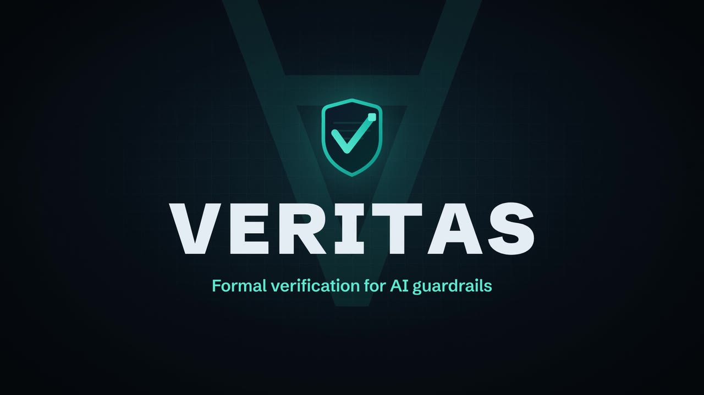
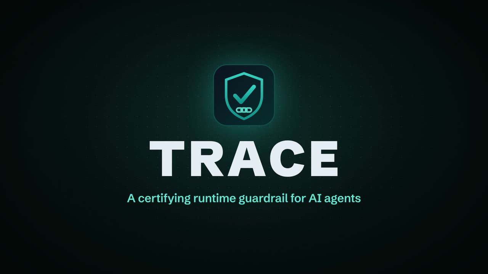
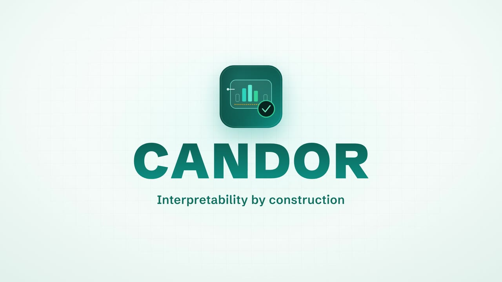
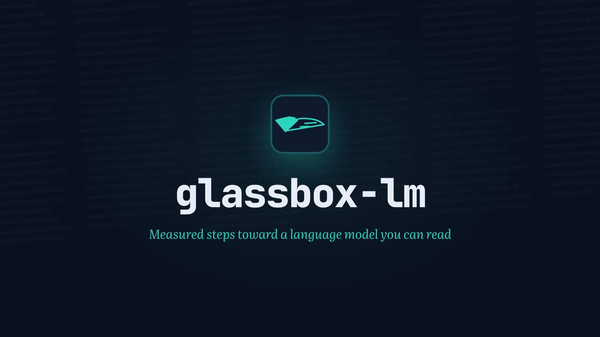

<a href="https://anwardebes.github.io">
  <picture>
    <source media="(prefers-color-scheme: dark)" srcset="assets/banner-dark.webp">
    
  </picture>
</a>

I research Tsetlin Machines at [CAIR](https://cair.uia.no), University of Agder: models whose every decision is a set of logical clauses you can read, check and argue with. Outside the lab I build game-playing agents, data warehouses and apps that run entirely in your browser. I am also CFO at [SafeMediAI](https://safemediai.com), and in 2025 my bachelor thesis team at NTNU won the [Eurekaprisen](https://nyheter.ntnu.no/disse-har-vunnet-eurekaprisen-2025/#:~:text=Automatic%20Removal%20of%20Sensitive%20Content,Yasin%20Hessnawi).

Press the pins on [my website](https://anwardebes.github.io), try to sneak a prompt past [my guardrail](https://anwardebes.github.io/#demo), turn the [research map](https://anwardebes.github.io/universe/) in 3D, or open [a whole desktop in your browser](https://anwardebes.github.io/PocketOS/).

## The short version, in 105 seconds

https://github.com/user-attachments/assets/8a5d37ca-770b-4ab7-9a19-739b00e571e9

A wall of steel pins plays every scene, every word is written on screen the moment it is spoken, and the last frame is a QR code made of pins: scan it.

<b>Read the transcript</b>

 

> Most AI hands you an answer. Very little of it shows you why. Anwar Debes builds the kind that does.
>
> At the University of Agder, he researches Tsetlin Machines: models whose every decision is a set of logical clauses you can read, check, and argue with.
>
> His master's research, glassbox-lm, takes measured steps toward a language model you can read. Ninety-one hypotheses, written down before the runs. Every result reported as measured, including the ones that did not work.
>
> He builds AI you can check. VERITAS proves a guardrail's safety rules, or hands you the exact input that breaks one. TRACE catches an attack hidden in innocent steps, and signs a ledger anyone can verify. CANDOR puts a certificate on every answer a network gives.
>
> At NTNU, his bachelor team won the Eureka Prize for software that finds and removes sensitive content in images and documents. Today, he is CFO of SafeMediAI, the Norwegian startup behind DeclassifAI.
>
> Outside the lab, he builds game-playing agents, data warehouses, and apps that run entirely in your browser. Even his coding agent shows its work: Pixie acts out every step.
>
> One rule runs through all of it. If a system makes a claim, it should show its work. Anwar Debes.

## Spotlight: Pixie, a coding agent you can watch work

https://github.com/user-attachments/assets/d4fe63eb-93f0-4408-9867-dc253bb104a8

**[Claude Code, in motion](https://github.com/AnwarDebes/Claude-Code-In-Motion)** is my open-source coding agent for any model. Instead of a spinner, Pixie, a coral pixel creature, acts out every step: reading, searching, editing, running the tests. Nothing is edited or run until you say yes, it has zero runtime dependencies, and it runs on your own key. [Try the live demo](https://anwardebes.github.io/Claude-Code-In-Motion/) right in your browser, or install it with `npm i -g github:AnwarDebes/Claude-Code-In-Motion`.

## Research you can run

Four projects as live demos. Each runs the actual method in your browser tab and is tested against the project's own code or an independent checker, and each has a film under a minute long.

<table>
<tr>
<td width="50%" valign="top">

**[VERITAS](https://anwardebes.github.io/veritas/)**: a SAT solver in your tab checks a prompt-injection guard against every possible input, finds a bypass, repairs it and hands you a proof that a standard checker accepts. 
[Open it live](https://anwardebes.github.io/veritas/) · [Watch the film](https://github.com/AnwarDebes/veritas#live-prover) · [Code and paper](https://github.com/AnwarDebes/veritas)

</td>
<td width="50%" valign="top">

**[TRACE](https://anwardebes.github.io/trace/)**: every tool call looks innocent and the session is not. Monitors with a few hundred bytes of memory catch it, and a signed ledger shows any edit. 
[Open it live](https://anwardebes.github.io/trace/) · [Watch the film](https://github.com/AnwarDebes/trace#live-demo) · [Code and paper](https://github.com/AnwarDebes/trace)

</td>
</tr>
<tr>
<td width="50%" valign="top">

**[CANDOR](https://anwardebes.github.io/candor/)**: a trained network that reads its input through named concepts and certifies every answer. Switch a concept off or plant a backdoor, and watch the certificate respond. 
[Open it live](https://anwardebes.github.io/candor/) · [Watch the film](https://github.com/AnwarDebes/candor#the-glass-box) · [Code and paper](https://github.com/AnwarDebes/candor)

</td>
<td width="50%" valign="top">

**[glassbox-lm](https://anwardebes.github.io/glassbox-lm/)**: ten public-domain books counted in your tab. Every next word is a sum of clause votes you can read, each traced to the page it was counted on. 
[Open it live](https://anwardebes.github.io/glassbox-lm/) · [Watch the film](https://github.com/AnwarDebes/glassbox-lm#the-glass-box) · [Code and studies](https://github.com/AnwarDebes/glassbox-lm)

</td>
</tr>
</table>

## About

- Master's student in Artificial Intelligence at the University of Agder, researching under Ole-Christoffer Granmo, who introduced the Tsetlin Machine
- Building [glassbox-lm](https://github.com/AnwarDebes/glassbox-lm): steps toward a language model whose knowledge is a set of readable clauses
- [Eurekaprisen 2025](https://nyheter.ntnu.no/disse-har-vunnet-eurekaprisen-2025/#:~:text=Automatic%20Removal%20of%20Sensitive%20Content,Yasin%20Hessnawi) for the best bachelor thesis at the Faculty of Information Technology and Electrical Engineering, NTNU Gjøvik: [*Automatic Removal of Sensitive Content in Images and Documents for Efficient Archiving*](https://hdl.handle.net/11250/3203861), written with Rami Amer and Yasin Hessnawi for Mattilsynet
- Bachelor in computer engineering, cybersecurity and programming, from NTNU Gjøvik
- CFO at [SafeMediAI](https://safemediai.com), the Norwegian startup behind [DeclassifAI](https://declassifai.com)
- Open to research collaborations on AI that helps people and holds up to scrutiny
- The short version of all this: [a one-page CV](https://anwardebes.github.io/cv/)

The common thread is systems that show their work: clauses you can read, certificates anyone can re-check, and hypotheses registered before the runs, with results reported as measured, including the ones that did not work.

## Research map

<a href="https://anwardebes.github.io/universe/">
  <picture>
    <source media="(prefers-color-scheme: dark)" srcset="assets/research-map-dark.svg">
    
  </picture>
</a>

Click the map to open the interactive version, where you can turn it, search it and take a guided tour.

## Most important work

Ranked by research weight, real measurements and how many people they can reach.

<table>
<tr>
<td width="50%" valign="top">

### [glassbox-lm](https://github.com/AnwarDebes/glassbox-lm)
Master's research, ongoing

Measured steps toward a language model whose knowledge is a set of readable Tsetlin Machine clauses. Three studies so far, with **91 hypotheses registered before the runs** in the first one alone, and every result reported as measured.

The README leads with what did *not* work. On purpose. [Read every vote of its count floor in your browser](https://anwardebes.github.io/glassbox-lm/).

</td>
<td width="50%" valign="top">

### [CANDOR](https://github.com/AnwarDebes/candor)
Interpretability by construction, with paper

A Legible Bottleneck routes a layer's computation through named concepts and emits a **Faithfulness Certificate** on every forward pass, re-checkable by anyone.

On synthetic ground truth: δ ≈ 0.002 (99.9% agreement) with no measurable accuracy cost, and backdoor detection at AUC ≈ 0.90. [Open the glass box in your browser](https://anwardebes.github.io/candor/).

</td>
</tr>
<tr>
<td width="50%" valign="top">

### [TRACE](https://github.com/AnwarDebes/trace)
AI safety, with paper

A CPU-only guardrail for AI agents: a Tsetlin content guard with readable clauses, bounded-memory temporal monitors, and a tamper-evident certificate ledger that can be verified without the model.

F1 **0.827** on deepset/prompt-injections at **107 µs** per check, in 12.5 KiB. [Try to fool it](https://anwardebes.github.io/#demo), or [watch it catch a session](https://anwardebes.github.io/trace/), in your browser.

</td>
<td width="50%" valign="top">

### [VERITAS](https://github.com/AnwarDebes/veritas)
Formal verification, with paper

An interpretable guardrail whose declared safety properties are proved or refuted by SAT and SMT solvers, with bypasses repaired by construction.

Retraining stalls at 8 provable bypasses. Constructive repair reaches **0** while accuracy goes from 0.69 to 0.71. [Watch it prove the guard in your browser](https://anwardebes.github.io/veritas/).

</td>
</tr>
<tr>
<td width="50%" valign="top">

### [LUCID](https://github.com/AnwarDebes/lucid)
ARC-AGI-3, with paper

A glass-box, safety-shielded agent for ARC-AGI-3, with a readable world model and a decision trace for every step. It runs on a CPU.

It completes **2** public levels (VC33 and LP85). Its overall score sits in the same sub-1% range as frontier models, and the README says so.

</td>
<td width="50%" valign="top">

### [graphtm-cbr](https://github.com/AnwarDebes/graphtm-cbr)
Cheminformatics and recourse

A graph-walking Tsetlin Machine for Ames mutagenicity that explains each prediction and proposes a minimal valid edit to the molecule.

Recourse succeeds for **95.5%** (191 of 200) of positives. Its AUROC of 0.685 trails a fingerprint baseline, and is reported anyway.

</td>
</tr>
</table>

**The safety stack:** [THGTM](https://github.com/AnwarDebes/THGTM) learns, [TRACE](https://github.com/AnwarDebes/trace) detects and certifies, [REINS](https://github.com/AnwarDebes/reins) enforces, and [VERITAS](https://github.com/AnwarDebes/veritas) verifies.

<b>All Tsetlin Machine work</b>

 

| Project | What it does | Measured |
|---|---|---|
| [DiTM](https://github.com/AnwarDebes/DiTM) | Generative Tsetlin Machine: discrete diffusion over Boolean vectors, readable at every step | anomaly ROC AUC 0.677 against 0.580 for naive Bayes |
| [REINS](https://github.com/AnwarDebes/reins) | Least-cost repair of AI agent tool calls under temporal safety policies | 3× the task completion of blocking at the same safety (synthetic) |
| [Clause-Driven-LLM](https://github.com/AnwarDebes/Clause-Driven-LLM) | Clause-based routing for LLM agents with SAT-checkable receipts | 94.2% on CLINC150 (logistic regression: 95.6%) |
| [THGTM](https://github.com/AnwarDebes/THGTM) | Echo-Trace automata and temporal literals for verifying whole agent trajectories | slow-roll exfiltration (synthetic): attack success 0.687 per step, 0.000 per trajectory |
| [attention-distilled-graphtm](https://github.com/AnwarDebes/attention-distilled-graphtm) | BERT attention edges as the graph, Boolean clauses on top | 94.77% mean on R8 (BERT teacher about 98%) |
| [Multi-HGTM](https://github.com/AnwarDebes/Multi-HGTM) | Multi-view Graph Tsetlin Machine with clause fusion | 0.968 against 0.727 for late fusion (synthetic) |
| [subword-dep-graphtm](https://github.com/AnwarDebes/subword-dep-graphtm) | Subword and dependency graphs for text classification | 95.05% mean on R8 |
| [decoder-attention-distill-graphtm](https://github.com/AnwarDebes/decoder-attention-distill-graphtm) | Decoder LLM attention as graph structure | 94.53% mean on R8 (work in progress) |
| [ConfTM](https://github.com/AnwarDebes/ConfTM) | Conformal prediction sets and recourse for Tsetlin Machines | coverage 0.900 at a 0.9 target under drift (synthetic) |
| [FedTM](https://github.com/AnwarDebes/FedTM) | Federated Tsetlin Machine with differential privacy | 0.875 accuracy at ε = 4 (synthetic) |
| [RobTM](https://github.com/AnwarDebes/RobTM) | Certified flip-distance robustness and abstention | certificate in about 0.05 ms per sample |
| [CCTM](https://github.com/AnwarDebes/CCTM) | Training on counterfactual pairs, with recourse receipts | demographic parity gap 0.041 against 0.181 (synthetic) |
| [HGTM](https://github.com/AnwarDebes/HGTM) and [RGTM](https://github.com/AnwarDebes/RGTM) | Hierarchical and recurrent Graph Tsetlin Machines | alpha, negative results documented |
| [lifelong-tm](https://github.com/AnwarDebes/lifelong-tm) | Continual learning for Tsetlin Machines | work in progress |
| [tm-llm-robustness-benchmark](https://github.com/AnwarDebes/tm-llm-robustness-benchmark) | One robustness harness for Tsetlin Machines and transformers | negative result: the TM loses 27 points on counterfactual IMDb, BERT loses 2 |
| [clauseguard](https://github.com/AnwarDebes/clauseguard), [clausegate](https://github.com/AnwarDebes/clausegate) and [clause86](https://github.com/AnwarDebes/clause86) | Clause-based audit layers for LLM claims, agent tool calls and hiring decisions | prototypes |
| [tsetlin-zoo](https://github.com/AnwarDebes/tsetlin-zoo) | A survey of Boolean clause learners | survey draft |

## Beyond Tsetlin Machines

Reinforcement learning, data engineering and apps you can open right now.

<table>
<tr>
<td width="50%" valign="top">

### [NEXUS](https://github.com/AnwarDebes/RL-CCA)
Reinforcement learning for 2 to 6 players

An AlphaZero-style agent for Chinese Checkers: a 7.5M-parameter convolution and transformer network, **Gumbel MCTS** within 0.45 s per move, and a rule-exact copy of the tournament server for self-play.

Three research prototypes run on top: coalition-aware search with a Plackett-Luce rank value, per-component values mixed inside the tree, and a network exactly equivariant to board rotations and seat swaps. **324 tests** pass on every push.

</td>
<td width="50%" valign="top">

### [PocketOS](https://github.com/AnwarDebes/PocketOS)
[Live demo](https://anwardebes.github.io/PocketOS/), best on a phone

A desktop that runs in a phone's browser: draggable, snapping windows, a virtual filesystem in IndexedDB, a terminal and a Monaco code editor, all on the client.

Installable and offline. On a narrow screen apps open full screen with an app switcher; give it room and the windows come back.

</td>
</tr>
<tr>
<td width="50%" valign="top">

### [SleepArchitect](https://github.com/AnwarDebes/SleepArchitect)
[Open the app](https://anwardebes.github.io/SleepArchitect/), with a [paper](https://github.com/AnwarDebes/SleepArchitect/blob/main/paper/sleeparchitect.pdf)

Predicts tonight's sleep before you go to bed, from Borbély's two-process model plus caffeine, alcohol, exercise, light and meal timing, then ranks what to change.

It reproduces all **11** published findings it was checked against. The whole app is 18.7 KB gzipped and sends nothing anywhere.

</td>
<td width="50%" valign="top">

### [IDM](https://github.com/AnwarDebes/IDM)
Data warehousing and streaming

An epidemiological data warehouse built three ways on the same **473,189** weekly disease reports from 1916 to 2011: a PostgreSQL star schema, MongoDB buckets and a Neo4j graph, behind FastAPI and a React dashboard.

Kafka and ksqlDB stream new reports in, validate them and raise alerts, and 13 decision-support queries run on all three back ends side by side.

</td>
</tr>
<tr>
<td width="50%" valign="top">

### [ThermoGuard](https://github.com/AnwarDebes/ThermoGuard)
Public health, with a [technical report](https://github.com/AnwarDebes/ThermoGuard/blob/main/paper/thermoguard.pdf)

Heatwave deaths happen indoors. ThermoGuard forecasts indoor heat home by home with a physics model of each building plus a learned correction, then decides who gets help first.

In a simulated replay of the 2021 Pacific Northwest heatwave, an equity floor lifts the worst-covered group from **0% to 11%** coverage, at a cost in total lives saved that the report spells out.

</td>
<td width="50%" valign="top">

### [Mneme](https://github.com/AnwarDebes/Mneme-Education-Ecosystem)
Local-first learning tools

Textbook in, Anki deck out, on a local model, so your notes never leave your machine. Every card says why it is easy or hard, optionally through a Tsetlin Machine.

**156** tests pass without a GPU, Ollama or Anki. The quality benchmark has not been run yet, and the README says so.

</td>
</tr>
<tr>
<td width="50%" valign="top">

### [vsclaude](https://github.com/AnwarDebes/vsclaude)
Developer tools, in beta

A desktop IDE where you watch your AI coding agent work. Pixie, a pixel-art companion, acts out what the agent is really doing, and every animation is bound to a real event. Built with Tauri, React and TypeScript. Pixie also runs on its own, in the browser, as [Claude Code, in motion](https://github.com/AnwarDebes/Claude-Code-In-Motion).

</td>
<td width="50%" valign="top">

### Climate and health simulators
Each with a technical report

[PyroPredict](https://github.com/AnwarDebes/PyroPredict), [SmokeShield](https://github.com/AnwarDebes/SmokeShield), [PipeGuard](https://github.com/AnwarDebes/PipeGuard), [HotCarWatch](https://github.com/AnwarDebes/HotCarWatch), [HomeJoule](https://github.com/AnwarDebes/HomeJoule) and [CaffeineSense](https://github.com/AnwarDebes/CaffeineSense): physics-based models of wildfire, smoke, frozen pipes, hot cars, home energy and caffeine, most of them running right in your browser.

</td>
</tr>
</table>

## Papers and technical reports

Every PDF lives next to the code that produced its numbers.

| Project | Paper |
|---|---|
| [**CANDOR**](https://github.com/AnwarDebes/candor/blob/main/paper/candor.pdf) | The Explanation Is the Forward Pass: Interpretability by Construction with Certified Legible Bottlenecks |
| [**TRACE**](https://github.com/AnwarDebes/trace/blob/main/paper/trace.pdf) | A Tsetlin Runtime Assurance and Certification Engine for Interpretable, Tamper-Evident Guardrails on Agentic AI |
| [**THGTM**](https://github.com/AnwarDebes/THGTM/blob/main/paper/thgtm.pdf) | A Temporal Hierarchical Graph Tsetlin Machine with Echo-Trace Automata for Trajectory-Level Verification of Agentic AI |
| [**VERITAS**](https://github.com/AnwarDebes/veritas/blob/main/paper/veritas.pdf) | Formally Verified, Competence-Aware Interpretable Guardrails for Language Models |
| [**REINS**](https://github.com/AnwarDebes/reins/blob/main/paper/reins.pdf) | Model-Free, Certifying Least-Cost Repair of LLM-Agent Tool-Call Trajectories |
| [**LUCID**](https://github.com/AnwarDebes/lucid/blob/main/paper/lucid.pdf) | A Glass-Box, Safety-Shielded Agent for Open-World Interactive Reasoning on ARC-AGI-3 |
| [**DiTM**](https://github.com/AnwarDebes/DiTM/blob/main/paper/ditm.pdf) | A Discrete-Diffusion Tsetlin Machine for Interpretable Generative Modelling of Tabular Boolean Data |
| [**Multi-HGTM**](https://github.com/AnwarDebes/Multi-HGTM/blob/main/paper/multihgtm.pdf) | Multi-HGTM: Cross-View Conjunctive Fusion for the Graph Tsetlin Machine |
| [**ConfTM**](https://github.com/AnwarDebes/ConfTM/blob/main/paper/conftm.pdf), [**FedTM**](https://github.com/AnwarDebes/FedTM/blob/main/paper/fedtm.pdf), [**RobTM**](https://github.com/AnwarDebes/RobTM/blob/main/paper/robtm.pdf) and [**CCTM**](https://github.com/AnwarDebes/CCTM/blob/main/paper/cctm.pdf) | Conformal, federated, robust and counterfactual Tsetlin Machines |
| [**Clause-Driven-LLM**](https://github.com/AnwarDebes/Clause-Driven-LLM/blob/main/paper/report.pdf) | An Interpretable Tsetlin Machine Control Layer for LLM Agent Routing and Escalation |

Plus a technical report for each of the eight climate and health simulators above, SleepArchitect and ThermoGuard included.

## Frequently avoided questions

**What is a Tsetlin Machine?** 
A learning algorithm built from teams of tiny automata that decide which inputs belong in logical AND-clauses. The clauses then vote, and every decision comes with the clauses that voted for it.

**Why not just use a neural network?** 
Sometimes I do. Then I distill what it learned into clauses and let it go. BERT once lent me its attention for a project; afterwards it was politely uninstalled.

**Do your experiments ever fail?** 
Regularly, and I write it down. glassbox-lm registers its hypotheses before the runs and publishes the misses right next to the hits.

**What does a CFO do at an AI startup?** 
Keeps the runway longer than the training runs.

**"Black boxes belong on airplanes"?** 
Fun fact: flight recorders are painted bright orange so they are easy to find. Even aviation agrees that if it matters, it should be visible.

## Activity

<picture>
  <source media="(prefers-color-scheme: dark)" srcset="https://raw.githubusercontent.com/AnwarDebes/AnwarDebes/output/contrib-3d-dark.svg">
  
</picture>

<picture>
  <source media="(prefers-color-scheme: dark)" srcset="https://raw.githubusercontent.com/AnwarDebes/AnwarDebes/output/snake-dark.svg">
  
</picture>

## Toolbox

Python, PyTorch, C++, Rust, TypeScript, React, Next.js, Tauri, Three.js, FastAPI, PostgreSQL, MongoDB, Neo4j, Kafka, Docker, Linux and Git.

 

Thanks for reading this far. If one of these projects is useful to you, a star helps other people find it.
